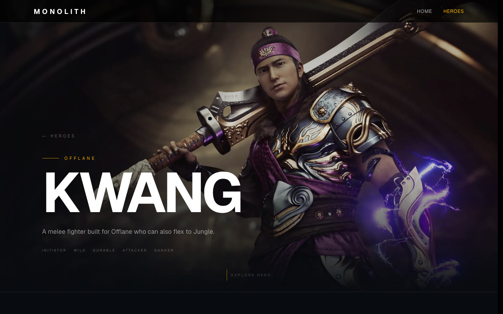
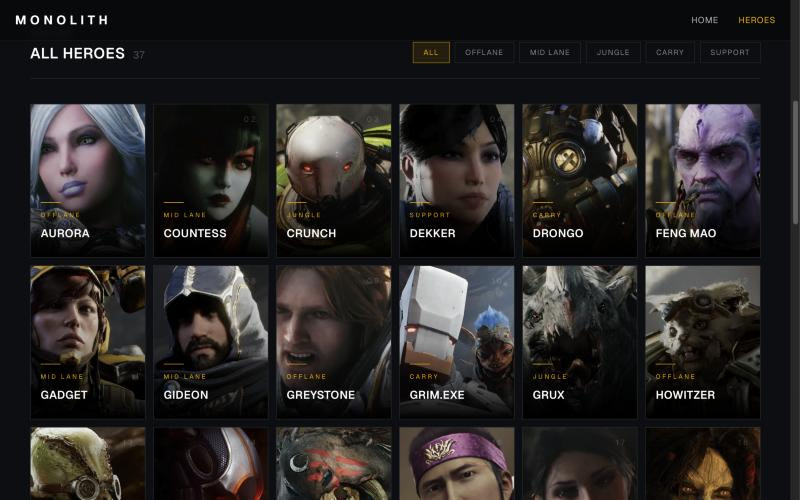
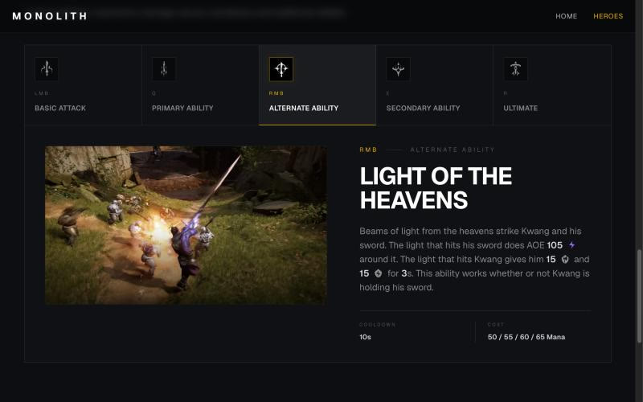
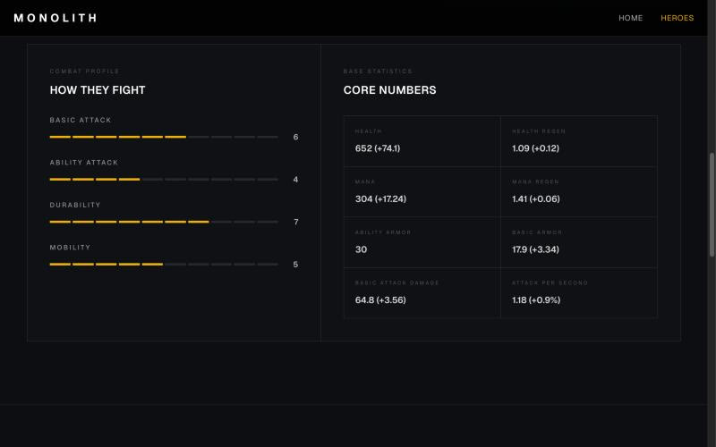
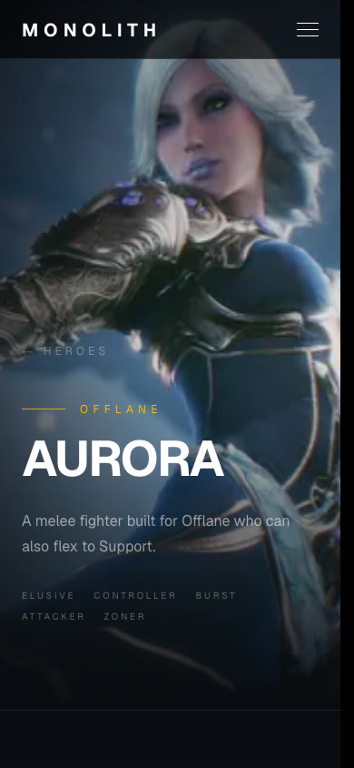

# Monolith

**Live site: [project-monolith-beta.vercel.app](https://project-monolith-beta.vercel.app/)**

An unofficial reference site for **Paragon v45**, Epic Games' discontinued third-person MOBA. It has all 37 heroes with their stats, abilities, ability videos and art, built from data extracted from the game files.

Built with **Next.js 16** (App Router), **React 19**, **TypeScript** and **Tailwind CSS 4**, and deployed on Vercel.

> Monolith is a non-commercial fan project. It is not affiliated with or endorsed by Epic Games. Paragon and all of its art and data belong to Epic Games.



## Features

- **37 hero pages**, each with a profile, combat ratings, base stats with per-level growth, and all five abilities. Every ability has its description, cooldowns, costs and an in-game preview video.
- **A roster filtered by role.** The filter lives in the URL (`/heroes?role=jungle`), so a filtered view can be shared and works with the back button.
- **Responsive from 375px phones up to wide desktops.** The roster goes from 2 to 6 columns, and the ability tabs collapse to icons on small screens.
- **Accessible:**
  - the ability picker is a keyboard-operable tab list;
  - every control has a visible focus outline;
  - Escape closes the mobile menu;
  - autoplaying videos pause for visitors who prefer reduced motion.
- **Static and fast:** every hero page is pre-rendered at build time, and unknown hero URLs return a real 404.

| Roster | Abilities |
|---|---|
|  |  |

| Stats | Phone |
|---|---|
|  |  |

## How the hero data was built

The game is no longer online, so nothing could be scraped from the web. Instead, the data comes straight from a local copy of the v45 client:

```
Paragon v45 game files (.pak, Unreal Engine 4.19)
        │  exported with a small .NET tool built on CUE4Parse
        ▼
JSON (data tables, curve tables, localization) + PNG (portraits, icons)
        │  scripts/import-heroes.mjs
        ▼
data/heroes/<slug>.ts       typed CompleteHero objects, one file per hero
public/images/hero/<slug>/  portraits, banners and ability icons
        │  Next.js generateStaticParams
        ▼
37 statically generated hero pages
```

[`scripts/import-heroes.mjs`](scripts/import-heroes.mjs) does the translation from game data to site data:

- **Lanes:** maps the game's internal position tags (`SafelaneOne`, `Midlane` and so on) to the site's five roles.
- **Stats:** turns 30-level stat curves into a base value plus per-level growth.
- **Ability text:** fills description tokens like `{Damage}` with real numbers. It also converts the game's rich-text markup (`<attr id="EnDmg"/>`, `<status id="stun"/>`) into typed parts that render as colored damage and status icons.
- **Images:** copies and converts the art with ffmpeg.

Its output is ordinary TypeScript, so the compiler checks every hero against the same types as hand-written code. Re-running the script regenerates everything, and hand-picked overrides live in the script, so they're never lost.

## Engineering notes

- **A discriminated union for heroes:** `Hero = CompleteHero | PlaceholderHero`, keyed by `status`. A page can't read stats from a hero that hasn't been written up, because TypeScript won't allow it.
- **One source of truth for roles:** [`data/roles.ts`](data/roles.ts) is an `as const` array, and the `RoleSlug` type and the `isRoleSlug` type guard come from it. That one list drives the home page, the roster filter and validation of the `?role=` query.
- **The WAI-ARIA tabs pattern** for abilities ([`AbilityShowcase.tsx`](components/AbilityShowcase.tsx)): a roving tabindex, arrow, Home and End keys, and a `tabpanel` labelled by the active tab.
- **Reduced motion done properly:** [`AmbientVideo.tsx`](components/AmbientVideo.tsx) reads `prefers-reduced-motion` with `useSyncExternalStore`, so it stays in sync if the setting changes. Decorative clips pause on their first frame, and content clips get player controls instead.
- **Media budget:** the 185 ability clips are VP9 WebM at 720p with no audio, about 2 MB each. Images go through `next/image`, so visitors get resized WebP versions.

## Getting started

```bash
npm install
npm run dev
```

Then open <http://localhost:3000>.

Other scripts:

- `npm run build`: production build
- `npm run start`: serve the production build
- `npm run lint`: run ESLint

## Project layout

```
app/
  page.tsx                   Landing page (overview, gameplay, battlefield, objectives, roles)
  heroes/page.tsx            Hero roster with the role filter
  heroes/[slug]/page.tsx     Hero detail page (statically generated for every hero)
components/                  Page sections and shared UI
data/heroes/                 One generated file per hero, plus types.ts and roster.ts
data/roles.ts                The five team roles
public/
  images/hero/<slug>/        Portraits, banners, ability icons, skin art
  videos/heroes/<slug>/      Ability preview clips (.webm)
  icons/paragon/             In-game stat and status icons (SVG)
scripts/import-heroes.mjs    Generates data/heroes/ from a Paragon v45 data export
docs/screenshots/            Images used in this README
```

## Regenerating hero data

The import script needs the game-file export (not included in this repo) and `ffmpeg`:

```bash
node scripts/import-heroes.mjs <path to monolith-export>
```

It writes `data/heroes/<slug>.ts` and the hero images. Full-body hero renders can be layered over the header banners by switching on `useFullBodyRenders` in the script.

Ability descriptions are arrays of `text`, `bold` and `icon` parts. Icon names match the SVG files in `public/icons/paragon/` (without `.svg`), and `color` picks the damage or status color.
